# 站点 UI 审查 · 2026-10-18

审查对象：`kreiitor.github.io` 当前 `dist/`（构建于 2026-10-18 13:55，晚于全部 `src/` 修改，可代表当前源码）。
方法：Playwright 1.64 驱动 Chromium，对 **10 个页面 × 12 个宽度（1440/1280/1024/900/800/768/700/600/480/390/360/320）× 明暗两主题** 取样，逐节点测量几何、对比度、点击目标、标题层级；另做交互脚本（键盘、搜索、菜单、主题切换）。

三个硬指标先给结论：

| 指标 | 结果 |
|---|---|
| 横向溢出 | **0 处**（含 320px，所有页面 `scrollWidth == clientWidth`） |
| WCAG 对比度失败 | **0 处**（脚本报的 3 条是 SVG `<text>` 误报，实测 `#edf2ff` on `#304bbd` = 6.57:1） |
| 点击目标 < 44px | **9 类**，其中 3 类低于 WCAG 2.2 AA 的 24px 下限（页脚链接 21、标题锚点 14、移动目录 summary 23） |

也就是说：**基础工程质量是好的**，问题集中在「局部样板走样」「组件语义不一致」「断点之间的空档」，以及一批可以直接看出是"忘了写"的地方。下面按严重度排列，最后单独给一段美学判断。

---

## 先说美学：这套视觉的判断

**身份是清楚的。** 纸色底（`#f7f6f2`）+ 墨蓝（`#18243a`）+ 品牌蓝（`#2448d8`）+ 一格荧光黄（`#e5ee95`），配 Lora/Source Serif 的衬线展示、DM Sans 的 UI、逐级编号的眉标（`01 / SELECTED WRITING`）——这是"数字花园 + 印刷刊物"的混合体，气质统一，不像模板。

**四个让气质打折的地方：**

1. **所有内页共用同一副骨架。** 博客、项目、学习、话题、归档、关于、画廊，开头全都是：眉标 → 44px 楷体标题 → 两行导语 → hairline。远看几乎分不出是哪一页。至少让两页破一下例——标签页可以去掉大标题、直接以网格开场；归档页可以让"年份"占满左侧栏——节奏立刻就活了。
2. **插画是全站最弱的资产。** 那套淡紫底 + 细线框图 + 极小标注的配图，在 544px 宽时还算成立，一旦掉到 300px（卡片缩略图、平板）或 104px（移动 hero）就只剩噪点。而它的比例是固定的 800×420，跟排版一样刚性。要么给列表行去掉封面、让文字自己撑住（这也更"刊物"），要么重画一套能在 200px 下依然可读的图。
3. **蓝的分量过重。** 蓝同时担任链接色、装饰色、以及一块 380px 的实心面板（hero）。页面其余部分极其克制，这块饱和蓝是视觉上最响的东西，会跟标题抢注意力。往墨蓝靠（`#2a3f7a` 一类）或改成纸底 + 蓝线稿，会更贴合"印刷物"的隐喻。

   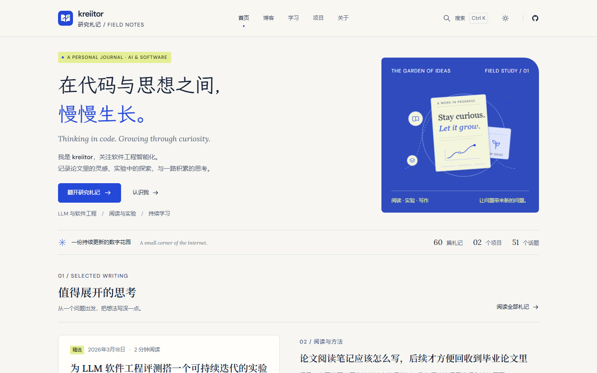

4. **右半边经常是空的。** 分区标题的动作链接贴右、筛选行右侧空着、文章页 180px 的目录沟——版心是左重的，很多行的右半截没有内容。这不一定是错，但目前是"偶然空"而不是"有意空"：留白没有形状，就会读作没排完。

这四点的共同点是：**问题不在细节，在于版式的"变奏"太少**。加两三个页面级变体，比修二十处间距更能提升整体观感。

---

## P0 · 一眼可见的缺陷

### 1. 项目详情页的「阅读位置」条跑到版心外面

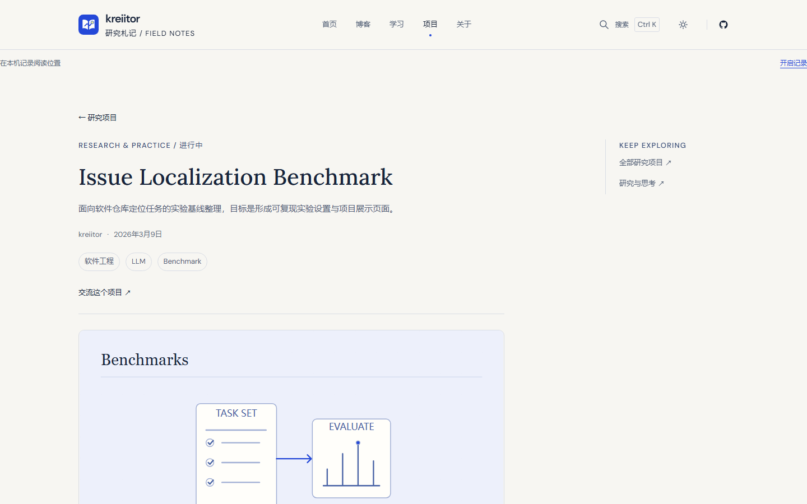

那条 `在本机记录阅读位置 ……… 开启记录` 横贯整个视口（x=0 → 1440），贴在 header 正下方，和页面 140px 的版心完全脱节；而文章页里它是收在 760px 正文列里的。

根因：`src/pages/projects/[slug].astro:17` 把 `<ReadingTools/>` 写在了 `<section class="page-shell project-reading">`（同文件 `:18`）**外面**：

```astro
<BaseLayout …>
 <ReadingTools/>                     <!-- ← 在 page-shell 之外 -->
 <section class="page-shell project-reading">…
```

`.reading-memory`（`src/components/ReadingTools.astro:190`）本身只有 `display:flex` 和 6px 内边距，宽度由父级决定，于是撑满 `<main>`。

建议：把 `<ReadingTools/>` 移进 `section` 内部（`src/pages/projects/[slug].astro:18` 之后）、`<article>` 之前，与 `src/components/ArticlePage.astro:46` 的结构保持一致即可，不用改任何样式。

---

### 2. 搜索：零命中仍然返回结果，且文案自相矛盾

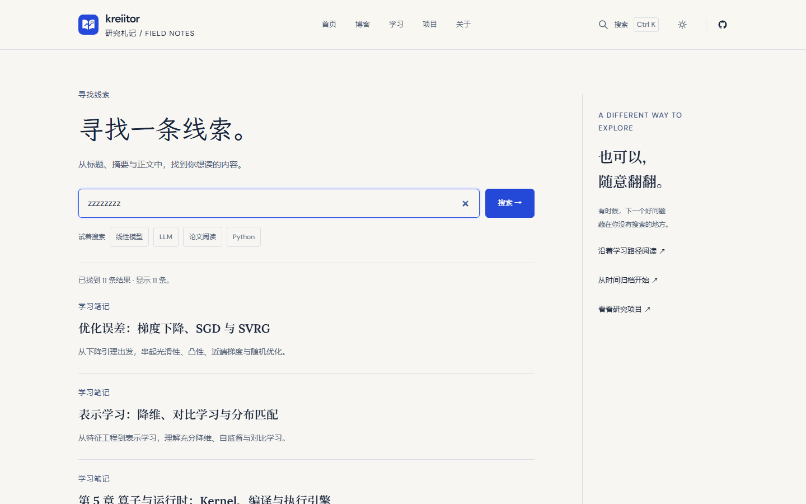

搜 `zzzzzzzz`，页面显示「已找到 11 条结果 · 显示 11 条。」，下面是「优化误差：梯度下降、SGD 与 SVGR」这类毫无关系的文章。空结果态实际上**不可达**。

两层原因叠在一起：

- `src/utils/search.mjs:11-14` 的 `rankSearchEntries` 只排序、不过滤，0 分条目照样留在数组里；
- `src/components/SearchPanel.astro:87` 本来用标题命中做了过滤，但紧接着 `collect()`（同文件 `:58-71`）拿 pagefind 的 hits 去**完整 catalog** 里重新取条目，把过滤结果又灌了回来。

同一段还有文案 bug（`SearchPanel.astro:56`）：

> 已找到 15 条结果，**可继续查看更多 · 显示 12 条**。

「可继续查看更多」后面紧跟「显示 12 条」，自相矛盾；而且界面上并没有"查看更多"的入口。

建议：

```js
// search.mjs
const scored = entries.map(e => ({ e, s: score(e, q) })).filter(x => x.s > 0);
```
并在 `SearchPanel.astro` 里保留标题/摘要的分数阈值，`collect()` 只用于补全正文命中（或干脆去掉 secondary pass）。文案改成「15 条结果，显示前 12 条 · 查看全部」，并真的给一个链接到 `/search/?q=`。

---

### 3. 搜索弹窗：输入框里有内容时，Esc 不关闭

`<dialog>` 用 `showModal()`（`src/components/SearchDialog.astro:17`），弹窗底部明写「↑↓ 选择 · Enter 打开 · **Esc 关闭**」。实测：

| 场景 | 结果 |
|---|---|
| 输入框为空，按 Esc | 正常关闭（cancel → close） |
| 输入 "LLM" 后按 Esc | **只清空输入框，弹窗不关**；要再按一次才关 |

根因不在你们的 JS：`<input type="search">`（`SearchPanel.astro:10`）会原生吞掉 Esc 用来清空自己，`cancel` 事件根本不会触发。而全局 keydown 处理器（同文件 `:109`）判断了 `!modal`，在弹窗里恰好跳过。

建议在弹窗里接管：

```js
const input = root.querySelector('#quick-query');
input?.addEventListener('keydown', (e) => {
  if (e.key === 'Escape') { e.preventDefault(); dialog.close(); }
});
```
（同时把 `:109` 的 `!modal` 判断去掉，双保险。）

另外弹窗本身有两个设计问题，见 P3-3。

---

### 4. 移动端菜单：每一个**内部**链接都带着外链箭头 ↗

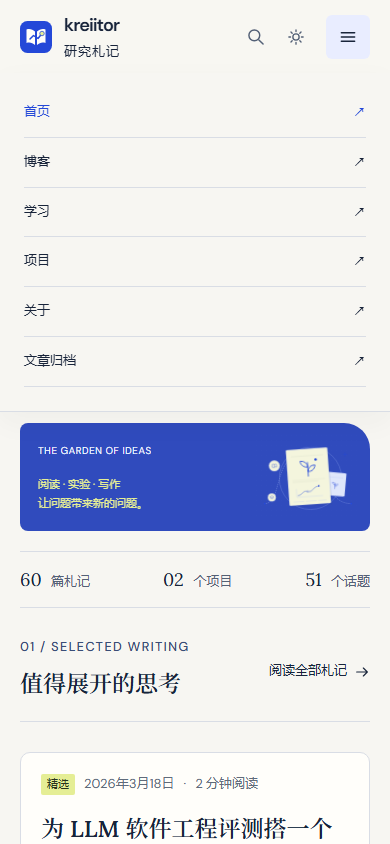

首页/博客/学习/项目/关于/文章归档，六行右侧全有 `↗`。桌面 nav 没有箭头，页脚的 EXPLORE 列也没有——这是移动端菜单独有的走样。

根因：`src/components/SiteHeader.astro:34` 在每个链接后硬编码了 `<span aria-hidden="true">↗</span>`；桌面 nav（同文件 `:18`）没有。

顺带两个小问题：

- `SiteHeader.astro:120` `.mobile-menu nav { top: 73px }`，而 header 实际高度是 74px + 1px 边框 = 75px → 下拉面板压住 header 底边 2px（截图里能看到那条线断开）；
- 菜单展开时没有遮罩、背后内容不变暗，只有 `overflow: hidden`（`src/styles/global.css:420`）。六行白底浮在内容上，层级感靠一条阴影撑着。

---

### 5. 移动端 hero 插画塌成一条 107px 的横带

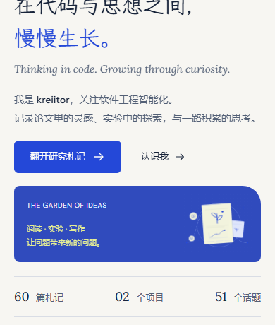

桌面这张卡是 380×335 的主视觉；在手机上它变成 350×**107** 的横带——`overflow: hidden` 把插画的下半截直接切掉（"Stay curious." 那张纸片只剩上半），左侧挤着 5 段 10–11px 的文字：`THE GARDEN OF IDEAS`、`阅读 · 实验 · 写作`、`让问题带来新的问题。`。

这看起来是想做一条"移动端横幅"，不是单纯的 bug，但压缩比太狠（335 → 107，高度掉 3 倍）。`src/components/ResearchArt.astro:72` 的规则：

```css
@media (max-width: 700px) {
  .research-art { padding: 12px 18px; display: grid; grid-template-columns: minmax(0,1fr) 88px; align-items: center; }
  .art-top { display: block; font-size: 10px; letter-spacing: .04em; }
  .art-top span:last-child { display: none; }
  svg { grid-column: 2; grid-row: 1/3; width: 104px; max-width: none; margin: 0 -8px; }
  .art-detail { display: none; }
  figcaption { grid-column: 1; display: block; font-size: 11px; line-height: 1.7; }
}
```

88px 的插画列 + 104px 的 svg（`margin: 0 -8px` 溢出到卡片外沿，再被 `overflow:hidden` 切掉），配上 `align-items: center`，结果就是"插画被裁、文字挤成三行"。

建议二选一（不要"再缩一缩"）：

```css
/* A. 收成一条真正的引文条：只留一行，插画退场 */
@media (max-width: 700px) {
  .research-art { display: flex; align-items: center; padding: 14px 16px; }
  .art-stage { display: none; }
  .art-top, figcaption { display: inline; font-size: 11px; }
}
/* B. 保留插画，给足高度：min-height: 180px，svg 不设负 margin，文字退到卡下方 */
```

现方案的问题不是"丑"，是**信息量为零还占着首屏 107px**。

---

### 6. 画廊页没有标题层级：h1 只有 15px

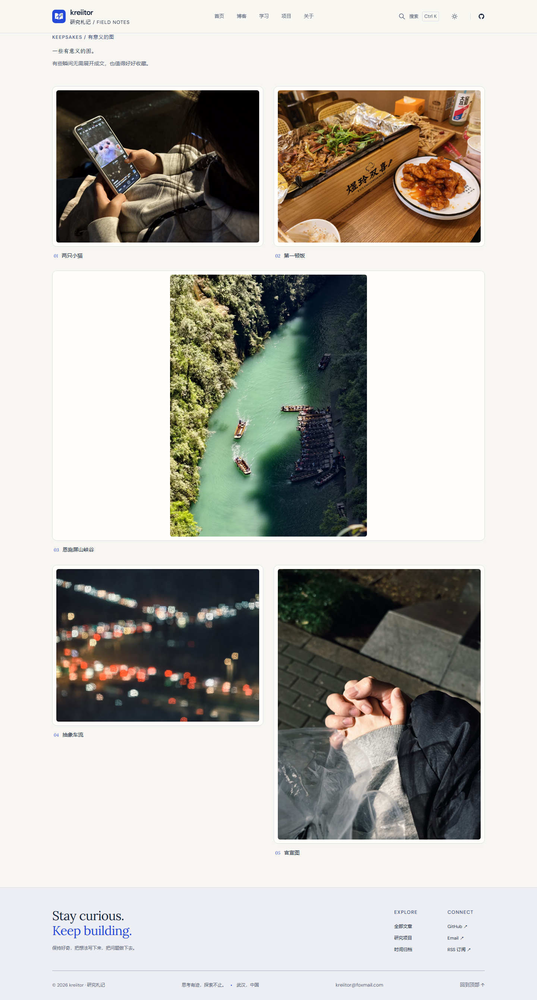

`KEEPSAKES / 有意义的图`（13px）→ `一些有意义的图。`（**15px**）→ `有些瞬间无需展开成文…`（14px）。三行视觉重量几乎相同，等于整页没有标题；也没有其他页面那条底部 hairline。

根因有两层，第二层是系统性的：

1. `src/pages/gallery.astro:15` 用的是 `<section class="page-shell gallery-head">`，而别的页面用 `.page-intro`（`global.css:116-118`，`padding-top:48px` + `border-bottom` + `h1: clamp(32px,4vw,48px)`）；
2. `src/styles/global.css:77` 的 `h1,h2,h3,h4` 只设了字体族/字重/行高，**没有 font-size**——于是任何漏掉 `.page-intro` 的页面，h1 会退回 Tailwind preflight 的 `font-size: inherit`，也就是正文 15px。

这属于"设计令牌有缺口"：把 `h1` 的基础字号补上（哪怕 `font-size: clamp(28px,3.5vw,44px)`），这类页面就不会静默退化。

---

### 7. 画廊的跨列竖图被塞进 1160 宽的白框

同一张图里第 3 张（恩施屏山峡谷，1205×1600 竖图）跨了两列，`gallery.astro:63`：

```css
.photo-wide .photo-frame img { max-height: 78vh; object-fit: contain; width: auto; max-width: 100%; margin: 0 auto; }
```

结果是 529×702 的照片居中躺在一个 1160 宽的白底相框里，左右各约 300px 纯空白，相框(`padding:10px` + 白底 + 边框 + 阴影)把这片空白也框了起来，看起来像"图没加载出来"。

建议：跨列时让 `figure` 本身收窄（`max-width: max-content; margin-inline: auto`），或干脆别跨列——竖图在两列网格里本来就该占一列，高度交给 `gap`。

---

### 8. 暗色主题里主按钮降级成了浅紫

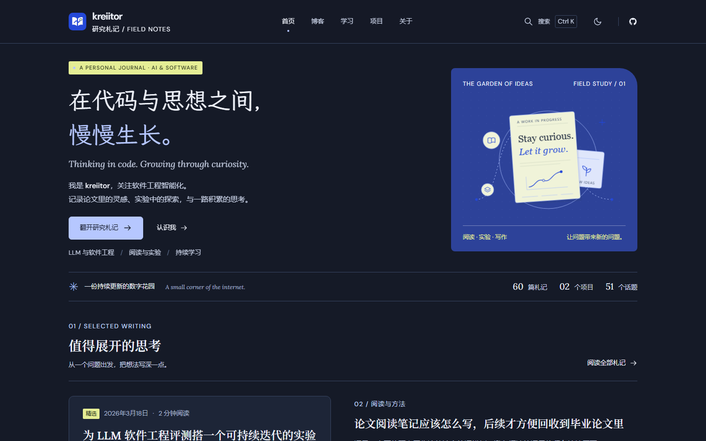

亮色下「翻开研究札记」是实心品牌蓝 `#2448d8`，暗色下变成 `#b6c7ff` 浅底 + 深字（`global.css:290`，以及 `:340` 的系统跟随分支）。同一位置，主次关系反了：主按钮看起来像次级按钮，而旁边的「认识我 →」还是同样的文字链接。

同时 hero 插画面板在暗色仍是 `#2d4299`（`global.css:286`），比页面背景亮一大截，是全站最亮的一块，把视线从标题上拽走。

建议：暗色主按钮保饱和（如 `#3d63ff` 底 + 白字，或 `#2448d8` 提亮到 `#4c6bff`），面板降到 `#22315f` 一类"暗色里的暗色"，让插画的浅色元素自己发光。

---

### 9. 博客 / 项目列表页标题跳级（h1 → h3）

`/blog/`、`/projects/` 的卡片标题是 `h3`，页面上没有 `h2`：

- `src/components/SeriesCard.astro:14`
- `src/components/ProjectCard.astro:16`

对屏幕阅读器来说，这是"从一级标题直接掉到三级"。既然这两页的卡片集合其实就是一个分区，加一个视觉隐藏的 `<h2>全部札记</h2>` 或把卡片标题降到 `h2` 都可以。

---

## P1 · 布局与断点

### 10. 文章页：正文与目录之间 180px 的空洞

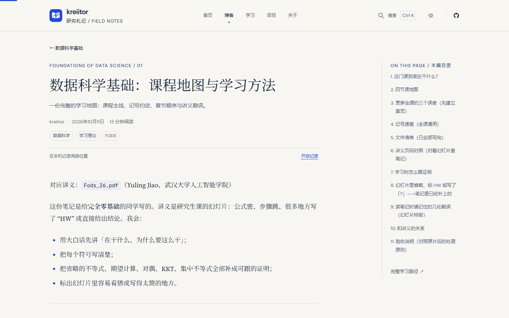

实测（1440）：版心 140→1300，正文 140→900（760 宽），目录 1080→1300（220 宽），**中间 180px 纯空白**。目录因此像一块"漂浮的孤岛"，那条 `border-left` 也失去了"贴着正文"的语义——它的左边距是自身宽度的 82%。

根因 `global.css:187`：

```css
.article-layout { grid-template-columns: minmax(0,760px) 220px; gap: var(--space-xl); justify-content: space-between; }
```

`gap` 是 64，剩余 116 被 `space-between` 全部塞进同一个间隙 → 实际 180。也就是说，这一段留白是**两个机制叠加**出来的：只改 `gap` 一点效果都没有，`space-between` 会把省下的额度再补回去。

真正可控的做法是让三列**正好撑满** 1160（不留余量给 `space-between` 去分配）：

```css
.article-layout {
  grid-template-columns: minmax(0, 800px) 300px;   /* 800 + 60 + 300 = 1160 */
  gap: 60px;
  justify-content: flex-start;                      /* 或直接删掉，不再分配余量 */
}
```

- 正文 760 → **800**：18px 字号下约 44 个汉字/行，仍在舒适区间（30–45），而目录与正文的间距从 180 收到 **60**；
- 目录 220 → **300**：「3. 贯穿全课的三个误差（先建立直觉）」这类长条目不再折行（220px 时 11 条里有 5 条折成两行）；
- 如果不想动正文宽度，退一步用 `grid-template-columns: minmax(0,760px) 340px` + 目录内部 `max-width: 260px; margin-left: auto`——间距会剩 140，仍然比 180 好，但不如上面干净。

注意 `global.css:228-230` 在 ≤1100 已经把 aside 隐藏、正文居中到 760，所以这套改动只影响桌面。

### 11. 700–1000px 是设计的无人区

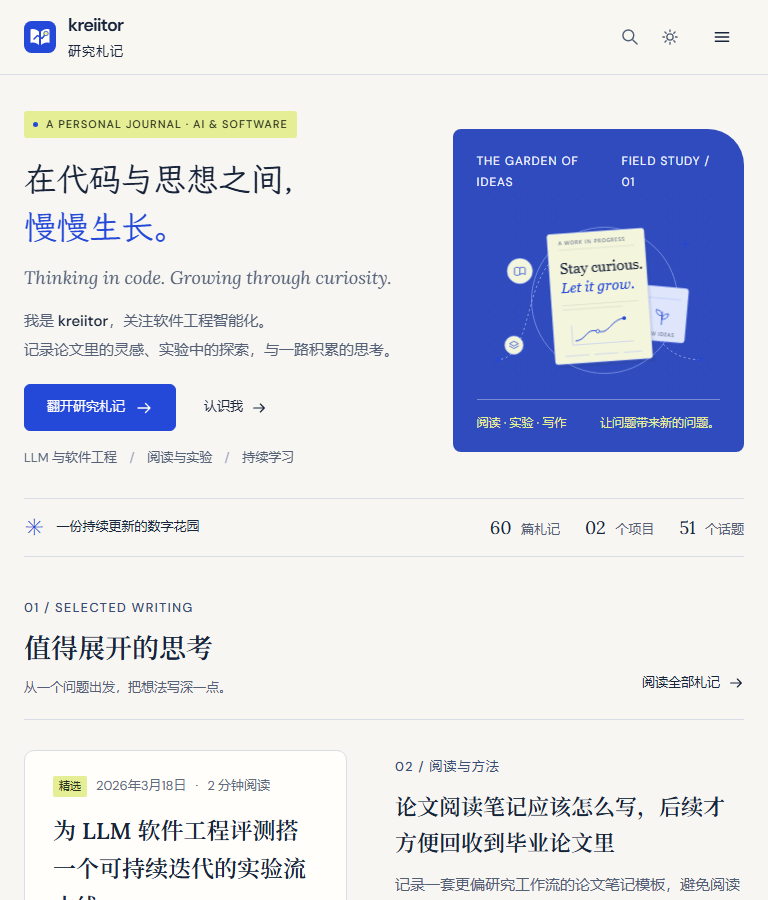

平板竖屏（768）拿到的是两列布局的最差形态：

- hero 保持 `1.35fr / 1fr`，插画只剩 **290px** 宽 →「THE GARDEN OF / IDEAS」「FIELD STUDY / / 01」各自折成两行，插画小到看不清；
- 精选卡片封面 800/420 在 300px 宽度下变成 157px 高的缩略图，里面的图完全不可读；
- 到 700px 才单列——也就是说 701–900 这段全部是"挤着但没换"。

建议把 hero 的换列点从 700 提到 **900**（接近 `section-grid` 的 900 断点），让平板也走单列；或者 700–1050 之间改成上下结构、插画整行。

顺带：断点目前散在 1101/1100/900/800/700/640/600 七个值，建议收成 **1200 / 900 / 640 / 390** 四档，减少"某个宽度只有这一处特殊"的情况（gallery 的 640 就是仅此一处）。

### 12. 320px：分区头被挤成两行

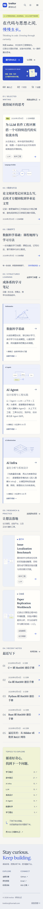

`02 / STRUCTURED LEARNING` 折成两行，右侧「全部学习专题 →」被 `padding-top: 24px` 顶到与第一行齐平，两者挤在 280px 里；`03 / RESEARCH & PRACTICE`、`04 / RECENT NOTES` 同样。

根因 `global.css:241-244`：`≤600` 时 `.section-heading` 改 `align-items: start`，同时给 `.text-link` 加 `padding-top: 24px` 做"视觉对齐"——在标题折行时这个假对齐就崩了。

建议 ≤600 时把动作链接**换行到标题下方**（`flex-wrap: wrap` + `width: 100%`），或直接隐藏 eyebrow 的动作链接、在区块末尾给一个「查看全部」。

### 13. 画廊网格行高不齐 + 图片不可放大

同一行里 04（1600×1205）和 05（1200×1600）顶部对齐、等高行，于是 04 下方留下约 315px 空白。另外所有图片**不可点击**——一个叫"画廊"的页面却不能看大图，是很直接的体验落差。

建议：`figure { break-inside: avoid }` + CSS columns 的瀑布流（`columns: 2` + `column-gap`），或者 `align-items: start` + 手动 `grid-row: span N`；点击开 `<dialog>` 看原图（你们已经有 `dialog` 的基础设施）。

---

## P2 · 尺寸与层级

### 14. 三级页面标题的尺寸/字面互不一致

| 位置 | 字号 | 字重 | 字面 |
|---|---|---|---|
| 首页 / 博客 / 项目 / 关于 / 标签 h1 | 48px | 400–500 | **楷体**（Journal Kai SC） |
| 文章页 h1（`global.css:190`） | clamp(28,3.2vw,40) → 1440 时 **40px** | 500 | **宋体**（Journal Serif SC） |
| 列表页 h1（`.page-intro h1`） | clamp(32,4vw,48) | 500 | 楷体 |

也就是说：**最重要的文章标题，是全站最小的 h1**，而且换了字面。768px 下文章 h1 只有 28px，比博客列表的 48px 小一大截。

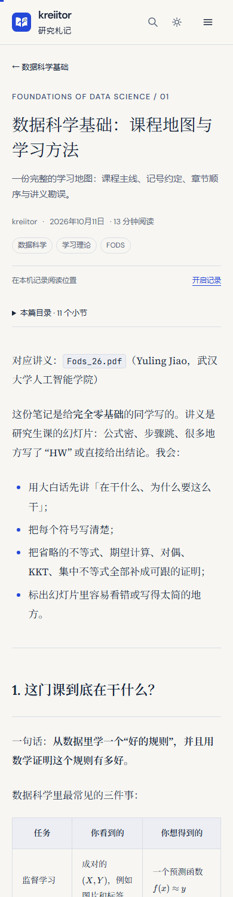

两件事需要定夺：

1. 楷/宋的分工是不是有意的？如果是，建议写进注释并固定成规则（"展示型页面用楷，阅读型页面用宋"），否则读起来像加载失败回退。
2. `Journal Kai SC` 只有 400 一个字重（`src/styles/fonts.css:33`），而 `h1` 默认 500（`global.css:77`）→ 页头 h1 全部靠浏览器**合成加粗**，笔画会发虚。要么把 h1 定成 400，要么补 500 字重子集。

顺带：`clamp(28px, 3.2vw, 40px)` 的下限要 875px 才被 vw 追上，1250px 才升到 40——也就是说 **875px 以下恒定 28px**（768 的平板、390 的手机都是 28），函数在移动端等于常数字体。

### 15. 卡片封面 `object-fit: contain` 造成大量留白

`global.css:121`：

```css
.card-cover img { width: 100%; height: 100%; object-fit: contain; }
```

封面是 800/420 的内容图（配图本身自带浅底），`contain` 在多数情况下没问题；但项目卡缩略图（`ProjectCard.astro`）是 148px 小方框，`contain` 会把「TASK SET → EVALUATE」整张图缩到看不清。建议小缩略图用 `cover` + `object-position: center`，或换成专门的方形缩略图。

### 16. 数字零填充不一致

首页统计条：`60 篇札记 · 02 个项目 · 51 个话题`（`src/pages/index.astro:48` 用 `String(count).padStart(2,'0')`，但 60 和 51 本来就两位）。视觉上「02」明显窄一档，衬线数字的对齐也被破坏。

建议：要么全部不补零（`60 / 2 / 51`），要么统一补到三位；或者干脆用等宽数字 `font-variant-numeric: tabular-nums`。

---

## P3 · 交互与状态

### 1. 点击目标清单（实测）

| 元素 | 尺寸 | 位置 | 评价 |
|---|---|---|---|
| 页脚链接（全部文章 / GitHub …） | **63×21** | 全站页脚 | **低于 24px**，WCAG 2.2 AA 不通过 |
| 标题锚点 `.heading-anchor` | 14px 高 | 文章正文 | **低于 24px** |
| `.mobile-toc summary` | 350×23 | 文章 ≤1100 | 低于 24px |
| `.text-link`（认识我 / 回到顶部 / RSS） | 高 32 | 全站 | 低于 44，可接受 |
| `.zen-tag` | 高 27–33 | 卡片、文章 | 低于 44 |
| `a.header-search` | 40×44 | 页头 | 略窄 |
| `a.card-arrow` | 36×36 | 卡片 | 可接受 |
| 搜索建议 chips | 高 36 | 搜索页/弹窗 | 低于 44 |
| 「开启记录」 | 48×36 | 文章 | 低于 44 |

最低成本的修法：给页脚链接和 `.text-link` 加 `padding-block: 11px`（保持视觉位置，用负 margin 抵消），达标且不改变版式。

### 2. 阅读记忆条：三个按钮抢一个位置

`ReadingTools.astro:4-5` 里有三个按钮：`开启记录` / `继续上次阅读 →` / `清除记录`，默认只显示第一个，12px 蓝字下划线，右边悬着。

问题不在功能，在于它在版面上的位置：夹在 header 和正文之间、横跨整列、中间大片空白（桌面 760px 列里左右各一头）。它读起来像一句"状态提示"，但实际是个可点的开关；而且**默认态是 `disabled`**（`:5`），JS 未执行时它是个死按钮。

建议：收进目录顶部或文章末尾一行「本机记录 ✓ / 清除」，用 13px 图标 + 文字，去掉横跨整列的双端对齐。

### 3. 搜索弹窗的排版与滚动


- 垂直空间分配失衡：eyebrow + 26px 标题「寻找下一条线索。」+ 描述 + 输入框 + 4 个 chips，占掉约 250px，结果区被挤到下半屏。命令面板应该一眼看到结果。
- 结果在 80vh 处被**硬切**，没有渐隐或滚动阴影，最后一条标题拦腰截断。
- 页脚的快捷键提示（↑↓ / Enter / Esc）在滚动容器**内部**，结果一多就滚出视野——它本该固定在底部。
- 圆角 16（`SearchDialog.astro:30`）是全站唯一，其他卡/按钮是 4/6/8/10/20。

### 4. 筛选 pill：桌面行内、移动端"表格"

`/blog/` 在 390 下变成 2×2 网格，`blog/index.astro:96` 的 `justify-content: space-between` 把计数推到卡片最右，形成四格里"数字贴边"的表格感；桌面是 `全部札记 60` 紧挨着。两套对齐规则读起来不像同一个组件。

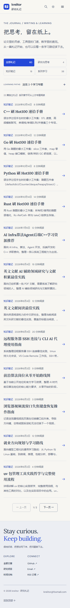

建议移动端也保持「文字 + 计数」紧邻（`justify-content: flex-start; gap: 8px`），pill 宽度按内容来。

### 5. LEARNING PATHS 的折叠条

- `×` 在整行最右，距左侧标签约 1000px。它其实是 `<summary>` 里的装饰字形，整行 1160×44 都可点——但**没有任何地方看得出来**，视觉上它读作"关闭整个页面"而不是"收起这一条"；
- 折叠状态只有一行「LEARNING PATHS 浏览 3 个学习专题」，没有"这里有内容"的暗示；
- `＋` 在展开时旋转 45° 变 `×`（`blog/index.astro:86` `[open] .series-disclosure { transform: rotate(45deg) }`）——同一个符号既是"收起"又是"删除"，语义打架。

建议：把 `×` 换成 `收起 ↑` 文字按钮并贴紧标签，右侧留一个 hover 才出现的整行提示；`+` 改 `▾`/`▸`。

### 6. 空态与占位

- `/search/` 初始态只有一行「输入至少 2 个字符开始搜索。」，下面约 **500px 空白**到页脚。建议放"最近更新 / 热门话题"两块内容。
- 文章末尾评论卡片常显「评论将在接近此处时加载。」——这是加载前的占位文案被固化成了正式内容，看上去像没做完。
- `/projects/` 卡片下的小注「↳ 项目不必一步到位…」是 13px 灰字，位置在卡片与页脚之间孤悬。

### 7. 章末「下一章」右对齐、左侧空半屏

`src/components/ArticlePage.astro:50` 的 `chapter-nav` 是两列网格（`:63` `grid-template-columns: repeat(2,minmax(0,1fr))`），本章是第一章、没有上一章时第一列是空的 `<div>`，于是「下一章 →」和下面的标题都被 `:67` 的 `text-align: right` 推到右边，左半屏空着；标题折行后 `Lasso` 单独一行挂在右侧。

建议：只有单项时用 `grid-template-columns: 1fr` 并左对齐（标签在上、标题在下），两项时才左右分列。

---

## P4 · 美学与一致性

### 1. `↗` 的语义被用坏了

`↗` 在这个站上是"外链/离开本站"的约定（页脚 CONNECT 列、GitHub、邮件、RSS 都正确）。但在这些地方被误用到了内链：

- 移动端菜单六项（`SiteHeader.astro:34`）
- 首页最近文章（`index.astro:69`）、话题列表计数（`:73`）
- 文章页目录底部「完整学习路径 ↗」（`src/components/ArticlePage.astro:54`）
- 项目详情 aside（`[slug].astro:18`）
- 归档页每一行（`archive.astro`）

建议：内链一律用 `→`（站内已有这套 `Icon name="arrow"`），`↗` 只留给真正跨站。这条改完，全站的"方向语言"会立刻干净。

### 2. 圆角体系漂移

设计令牌里的圆角是 4/6/8/10（徽标 4、按钮 6、卡片 10、标签 20 胶囊）。走样的是这两处：

| 元素 | 圆角 | 备注 |
|---|---|---|
| 搜索弹窗（`SearchDialog.astro:30`） | **16** | 全站唯一 |
| 画廊相框（`gallery.astro:46`） | **12** | 全站唯一 |
| 卡片 / 按钮 / 徽标 | 10 / 6 / 4 | ✓ 一致 |
| hero 插画面板（`ResearchArt.astro:55`） | `8px 36px 8px 8px` | 唯一的不对称折角 |

hero 那个"右上折角"是有意的视觉签名，建议保留并写进注释；16 和 12 更像临时值，收进 `4 / 6 / 10 / 20` 会更整齐。

### 3. 首页分区标题的动作链接高度不一致

`global.css:109` 的 `.section-heading { align-items: end }` 让 01/02/03 的链接对齐到描述行，而 04「最近写下」没有描述，链接就贴在 h2 基线——四个区块的链接位置各不相同。

### 4. 标签体系本身有重复

`/tags/` 51 个话题里同时存在 `C++` 与 `cpp`、`算法` 与 `algorithms`，还有 0 篇札记的 `Benchmark`（只挂在项目上）。设计侧做再多的卡片也盖不住分类混乱，建议先做一次标签归并（大小写统一、同义词映射），再考虑加搜索/筛选。

### 5. 归档页的信息密度

60 行、日期列每行都重复「2026年10月14日」、右侧每行一个 `↗`、没有月份分组。头部「2026 / 60 篇札记」占了 210px 宽做装饰，但真正有用的"按月分组"没有。建议：按月份加 sticky 小标题，日期列只留「14日」，行尾箭头换成 hover 才出现的 `→`。

### 6. 关于页的内容重复

右侧卡片「PERSONAL INTERESTS: AI 理论与应用 / 数学知识 / 文学阅读」与下方 01 列「个人兴趣: AI 的基础与应用 / 数学 / 阅读」是同一份内容，措辞还不一致。删一份，或让卡片只承担"身份信息"、01 列承担"兴趣详述"。

---

## 值得保留的部分

审查里最有价值的往往是"别动这里"：

- **排版系统**：13/14/15/18 四档字号 + Lora/Source Serif/DM Sans/JetBrains Mono 四族分工明确，衬线正文 18px/1.9、每行约 42 个汉字，是真的按阅读设计过的。
- **深浅色令牌**：显式选择与系统跟随两套完整重复，还有 `scripts/check-theme-tokens.mjs` 守着，这是很多站点做不到的。
- **`prefers-reduced-motion`**：全站时长归零 + `.zen-reveal` 直接置 `opacity: 1`，内容不会因动效禁用而消失。
- **键盘可达性**：skip-link、`:focus-visible` 统一 2px + 3px offset、`aria-expanded` 同步、`aria-current="location"` 目录高亮。
- **无 JS 兜底**：`noscript` 里解禁筛选行、隐藏阅读工具条、双 `theme-color`，考虑得很细。
- **首屏节奏**：眉标 → 楷体大标题（第二行撞色）→ 衬线斜体英文 → 双 CTA → 三个 meta 词 → hairline，这一串的呼吸感是成立的。

---

## 建议的动手顺序

| 顺序 | 事项 | 工作量 |
|---|---|---|
| 1 | 项目页 `ReadingTools` 归位 | 1 行 |
| 2 | 搜索 0 命中过滤 + 文案 | ~20 行 |
| 3 | 搜索弹窗 Esc + 页脚固定 | ~10 行 |
| 4 | 移动菜单去掉 ↗（+ 收起/展开图标语义） | 1 行 |
| 5 | 画廊 h1 补 `.page-intro` + base h1 字号 | 2 行 |
| 6 | 移动端 hero 插画面板重做 | 半天 |
| 7 | 文章页版心/目录宽度 | 半天 |
| 8 | 700–1000 断点重排 | 1 天 |
| 9 | 暗色主按钮 + 面板色 | 半天 |
| 10 | 点击目标统一（页脚/锚点/summary） | 半天 |
| 11 | `↗` → `→` 全站排查 | 半天 |
| 12 | 画廊瀑布流 + 灯箱 | 1 天 |

前 5 项加起来不到 40 行改动，但能消掉这次审查里"看起来像没做完"的全部印象。

---

## 附：复现方式

截图与度量脚本在 `.artifacts/design-audit-2026-10-18/`（不进版本库）：

- `serve.mjs` —— `dist/` 的静态服务器（`node .artifacts/design-audit-2026-10-18/serve.mjs`，监听 4321）
- `measure.mjs` —— 12 宽度 × 2 主题的度量，输出 `metrics.json`
- `shots/` —— 全部截图原图
- `esc.mjs` / `esc2.mjs` —— 搜索弹窗 Esc 行为验证
- `fonts.mjs` —— 各页 h1 计算样式对比
